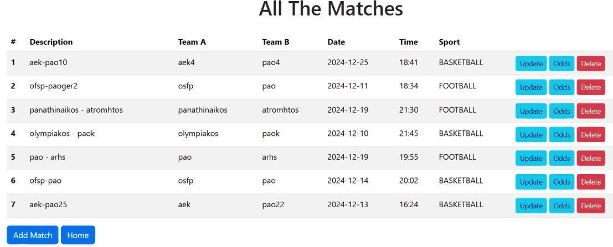
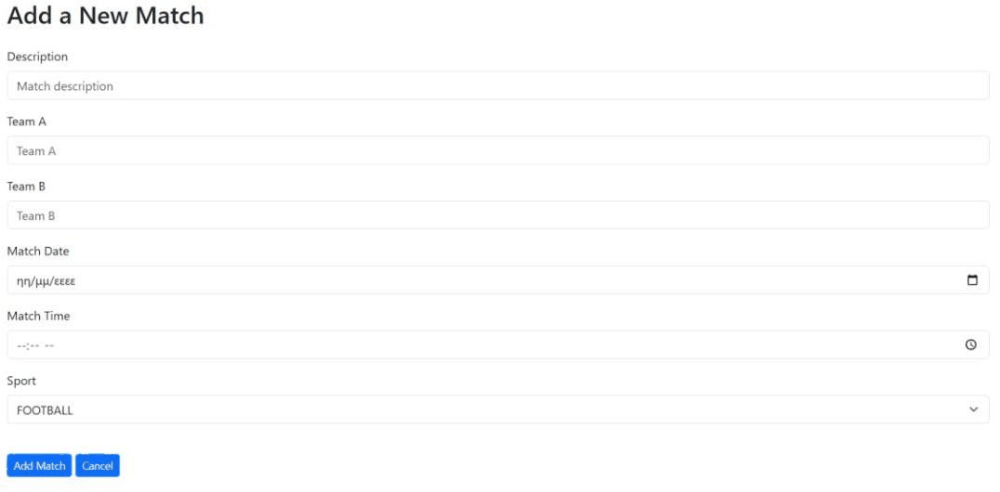
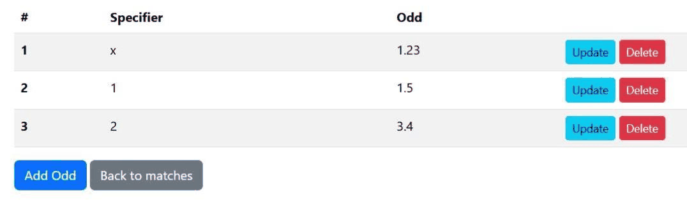

# Match app

A Spring Boot web app for managing sports matches and their betting odds. You can add, edit and delete matches, and the odds of each match. It follows MVC, with Thymeleaf pages and a PostgreSQL database with just two tables, the matches and the odds of each match. I made it in Eclipse.



<table>
  <tr>
    <td width="50%"></td>
    <td width="50%"></td>
  </tr>
</table>

## Running it

You need Java 23 and PostgreSQL. Maven isn't needed, `./mvnw` downloads it the first time (on Windows use `mvnw.cmd`). Create a database called `matchDB`. The connection settings are in `src/main/resources/application.properties` (user `postgres` on `localhost:5432`), change them if yours are different. Then:

```bash
./mvnw spring-boot:run
```

and open http://localhost:8080. The tables are created automatically.

The report (in Greek) is in [report.pdf](report.pdf).
